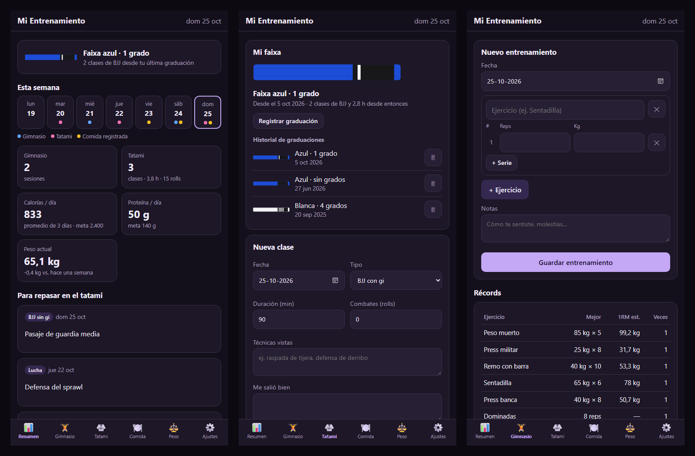

# Mi Entrenamiento

App web personal para anotar en un solo lugar el gimnasio, las clases de jiu-jitsu y lucha, lo que como y mi peso. Se usa desde el celular o el PC, funciona sin internet y los datos no salen del dispositivo.

**[Abrir la app](https://belenfg08.github.io/mi-entrenamiento/)**

*La captura usa datos de ejemplo inventados.*

## Qué hace

- **Resumen semanal:** los días de la semana con lo que se registró cada día, más sesiones de gimnasio, clases, horas y combates en el tatami, promedio de calorías y proteína, y cambio de peso.
- **Gimnasio:** ejercicios con series, repeticiones y kilos. Calcula récords y un 1RM estimado (fórmula de Epley). El botón «Repetir» carga una rutina anterior.
- **Mi faixa:** la faixa actual de BJJ (blanca, azul, morada, marrón o negra) con sus grados, dibujada como cinturón, más el historial de graduaciones y cuántas clases y horas de BJJ van desde la última. Al registrar una graduación, la app propone la siguiente (un grado más, o la faixa siguiente después del 4.º grado).
- **Tatami (BJJ con gi, sin gi, lucha, open mat):** duración, combates, técnicas vistas, qué salió bien, qué repasar, cansancio (1-10) y molestias. Tiene buscador.
- **Comida:** alimentos por momento del día, con barras de avance hacia la meta de calorías y proteína, y accesos rápidos a lo que más se repite.
- **Peso:** un registro por día, con gráfico e historial.
- **Ajustes:** metas diarias, descargar y restaurar un respaldo (`.json`), y borrar todo.

## Uso

1. Abre **[la app](https://belenfg08.github.io/mi-entrenamiento/)** en el navegador del celular.
2. Instálala como ícono en la pantalla de inicio:
   - **Android (Chrome):** menú ⋮ → «Agregar a la pantalla principal».
   - **iPhone (Safari):** botón Compartir → «Agregar a inicio».
3. Después de la primera visita abre también sin internet.

En el PC también se puede abrir `index.html` con doble clic; en ese caso no funciona el modo sin internet.

### Dónde quedan los datos

Todo se guarda en el almacenamiento local (`localStorage`) del navegador donde se usa la app. No hay servidor ni cuenta y nada se envía a internet. Por lo mismo:

- Los datos del celular y los del PC **no se sincronizan** entre sí.
- Si se borran los datos del navegador, se pierden los registros. Conviene usar **Ajustes → Descargar respaldo** de vez en cuando.

## Cómo está hecha

HTML, CSS y JavaScript sin librerías ni compilación. Es una *Progressive Web App*: `manifest.webmanifest` permite instalarla y `sw.js` guarda los archivos para que abra sin conexión.

## Cómo se verificó

- Se registraron datos de prueba en todas las secciones en un navegador con tamaño de celular (375 px), y se revisó que los totales, récords y promedios fueran correctos. Por ejemplo, 65 kg × 6 da un 1RM estimado de 78 kg.
- Se recargó la página para confirmar que los datos se mantienen, que no hay errores en la consola, que la página no se desborda a lo ancho y que el modo sin internet guarda todos los archivos.
- Faixas: se registró blanca con 4 grados y luego azul, y se revisó que la app propusiera la siguiente graduación, que la negra permita hasta 6 grados y que las clases de lucha no cuenten como clases de BJJ.
- No se probaron con un archivo real los botones de descargar y restaurar respaldo.

## Límites

- Sin sincronización entre dispositivos ni copia en la nube.
- No trae base de datos de alimentos: las calorías y la proteína se escriben a mano.
- Las faixas son las de adulto; no incluye las faixas infantiles (gris, amarilla, naranja, verde).
- El 1RM es una estimación y no reemplaza una prueba real ni la indicación de un profesional.

## Autoría

Belén Fuentes González. Desarrollado con asistencia de IA (Claude Code); las decisiones y la verificación son mías.

Licencia [MIT](LICENSE).
